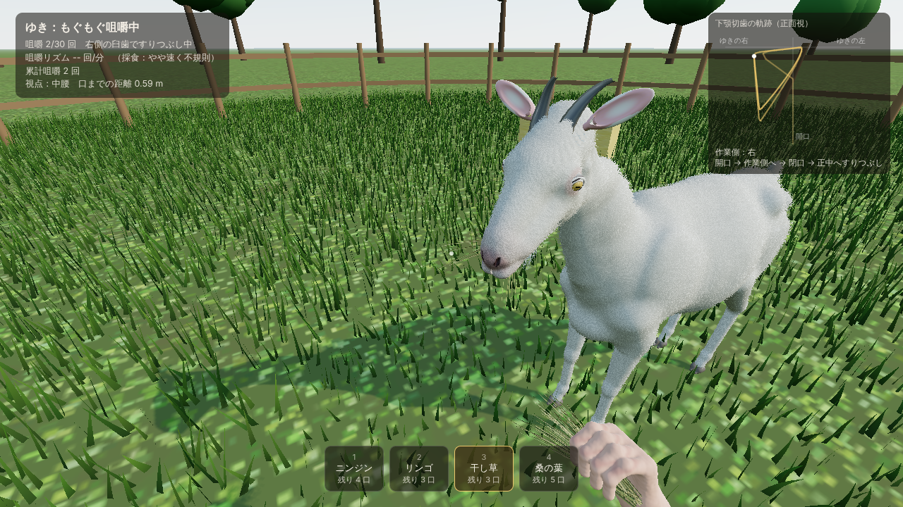

# treat_n_treat — ヤギの餌付け観察デモ

Three.js（WebGL）で動く一人称視点（FPS）の餌付けゲームのデモです。
ザーネン種のメスヤギ「ゆき」に手から餌をあげて、**口・唇・顎・舌の動き**と**咀嚼音**を、
人間が実際に取れる姿勢・視点の範囲で好きな角度から観察できます。



## 起動方法

```bash
npm install
npm run dev      # http://localhost:5173 を開く
# 本番ビルド
npm run build && npm run preview
```

- PC（マウス＋キーボード）とスマホ・タブレット（タッチ操作）の両方に対応しています。タッチ端末は自動判定されます
  （PC で試すときは URL に `?touch` を付けるとタッチ版、`?desktop` で PC 版を強制）。
- 🎧 立体音響（HRTF）を使っているので、ヘッドホン推奨です。
- 起動時にヤギの形状を Web Worker で生成するので、読み込みに数秒かかります。

## スマホで遊ぶ

PC で開発サーバーを LAN に公開し、同じ Wi‑Fi につないだスマホのブラウザで開きます。

```bash
npm run dev:phone        # 表示される Network: http://192.168.x.x:5173/ をスマホで開く
# または本番ビルドで
npm run build && npm run preview:phone
```

- 横向き推奨です（Android は開始時に全画面・横向き固定を試みます。iPhone は手動で横向きに）。
- iPhone は消音モードだと音が出ないことがあります（対応している iOS では消音スイッチ中でも鳴るよう設定しています）。
- スマホでは軽量設定になります：毛並みのシェル 6 層（PC は 14 層）、草 1.8 万本（PC は 6 万本）、描画解像度 最大 1.5 倍、影 1024px。
  それでも重い場合は自動で毛並み品質を下げます（右上「毛並み」ボタンでも切替）。
- 餌をかじられた瞬間に軽く振動します（Android のみ）。

### タッチ操作

| 操作 | 内容 |
| --- | --- |
| 画面左側をドラッグ | 歩く（仮想スティック。大きく倒すと少し速く） |
| 画面右側をドラッグ | 見回す（首の可動域：上 70° / 下 75°） |
| 🥕 あげる（長押し） | 手を差し出して餌をあげる |
| 👁 注視（長押し） | じっと見る |
| ⬇ 姿勢 | 立ち → 中腰 → しゃがみ |
| ◀ ▶（長押し） | 体を左右に傾けてのぞき込む |
| 下の餌ボタン | 餌を選ぶ |
| 右上のボタン | ≡ メニュー / スロー / 反芻 / 呼ぶ / 顎の軌跡 / 毛並み品質 |

複数の指を同時に使えます（歩きながら見回す、長押しで餌を差し出しながら視点を動かす、など）。

## 操作（PC）

| 操作 | 内容 |
| --- | --- |
| マウス | 見回す（首の可動域：上 70° / 下 75°） |
| W A S D | 歩く（Shift で少し速く） |
| C | 姿勢の切替：立ち（目線 1.58 m）→ 中腰（1.15 m）→ しゃがみ（0.82 m） |
| Q / E | 体を左右に傾けてのぞき込む（最大 24 cm） |
| 左クリック長押し | 手を差し出して餌をあげる |
| 右クリック長押し | じっと見る（注視） |
| 1〜4 / ホイール | 餌を選ぶ：ニンジン・リンゴ・干し草・桑の葉 |
| T | スローモーション（1× → ½× → ¼×） |
| J | 顎の軌跡モニターの表示切替 |
| R | 反芻（はんすう）を観察する |
| B | 名前を呼ぶ（メェ〜と返事をする） |
| F | 毛並みの品質切替（重いときに。遅い環境では自動で下がります） |

**視点の制約**：プレイヤーは「足が地面についた人間」として扱われます。目線の高さはしゃがみ（0.82 m）より下がらず、
体はカプセル形状でヤギの胴・首・頭のカプセルと衝突するため、ヤギの下に潜り込んだり、体や頭を貫通したりすることはできません。
体を傾けたときも、頭がヤギに当たる場合は傾きが自動で抑えられます。

## 観察できること

- **歯の構造**：上の切歯がなく、硬い**歯床板（dental pad）**と下の 8 本の切歯状歯で餌を挟み切ります。
  奥には前臼歯 3 本＋後臼歯 3 本（上下・左右）。切歯と臼歯の間には歯のない**歯隙**があります。
- **餌の取り方**：鼻先で匂いを嗅ぎ（鼻孔がひくつき、クンクン音）、口を開けて**割れた上唇**を前に突き出して餌をくわえ、
  頭をひねりながら引きちぎります。ニンジンやリンゴは食べるたびに**歯形**が残ります。
- **独特の顎の動き**：ヤギは上顎が下顎より幅広い（不等顎）ため、**片側ずつ**すりつぶします。
  1 回の咀嚼は「開口しながら作業側へ → 作業側で閉口 → 歯を当てたまま正中へすりつぶし（パワーストローク）」というループで、
  作業側は 8〜20 回ごとに左右が入れ替わります。右上の**顎の軌跡モニター**（下顎切歯先端の正面視の軌跡）で確認できます。
- **リズムの違い**：採食時の咀嚼は速くやや不規則（約 85〜95 回/分）、反芻時はゆっくり規則的（約 65〜70 回/分）。
- **咀嚼中の細部**：作業側の頬（咬筋）のふくらみ、上唇のぴくつき、舌が食塊を送る動き、顎に合わせて揺れるあごひげ、
  咀嚼に合わせた耳の付け根の動き、口の中で移動する食べかす、口からこぼれるかけら、口の端から垂れた干し草が少しずつ吸い込まれていく様子。
- **嚥下と反芻**：飲み込むと**首の左側（左頸静脈溝）**を食塊のふくらみが下っていきます。反芻では逆に食塊が首を**上がって**きて、
  液体を絞って飲み込んだ後、ゆっくり規則的に噛み直します（まぶたも少し重くなります）。
- **目**：横長の長方形の瞳孔。頭を上下させても瞳孔は地面と水平を保つように回転します。まばたき、視線の追従もあります。
- **その他**：呼吸に合わせた脇腹の動き、餌をもらって興奮すると尻尾を振る、耳のぴくつき、肉垂（首の房）とあごひげの揺れ、
  左側に張り出したルーメン（第一胃）、偶蹄の蹄と副蹄など。

## 音（すべて Web Audio API による手続き的合成、録音素材なし）

- **咀嚼音**：パワーストロークごとに、細かい「破砕粒」（数 ms のフィルタ付きノイズ）を多数重ねたクランチ音と、
  頭蓋骨を伝わる低い歯の衝突音。噛み進むほど硬いクランチが減り、湿ったすりつぶし音・唾液のクリック音に変わります。
  ニンジン（硬く乾いた破砕）、リンゴ（果汁の多いクランチ）、干し草（繊維がきしむ乾いたパチパチ音）、桑の葉（柔らかく湿った音）で音色が違います。
- **鳴き声**：喉頭音源（f0 ≈ 300〜450 Hz）を約 9〜11 Hz で断続的に震わせ（メェ・ェ・ェ…）、
  フォルマントで「m → eh」と口が開く変化をつけています。顎の開閉も声の震えに同期します。
- 噛み取る音（ポキッ・シャクッ・ブチッ）、嚥下のゴクッ、反芻の吐き戻しとルーメンのゴロゴロ音、嗅ぐ音、呼吸音、足音、風・鳥の環境音。
- 音源はヤギの口元に置いた HRTF パンナーから鳴り、顔を近づけるほど大きく、高域の細かいパチパチ音が聞こえるようになります。

## 技術メモ

- `src/goat/anatomy.js` — 骨格のランドマークと、楕円体・ラウンドコーンなどを smooth-min で合成したヤギの SDF（符号付き距離場）。
  寸法は成雌ザーネン（体高 ≈ 0.80 m、体長 ≈ 0.80 m）に合わせています。
- `src/sdf.js` — 粗いプリパスで表面付近だけを精密評価する「サーフェスネッツ」メッシュ化。胴体 7 mm、頭部・口腔 2.5 mm の解像度で生成し、
  頭部と胴体は首で重ねて継ぎ目が出ないようにしています。唇の隙間を解像するため、頭部は顎をわずかに開いた状態で造形し、実行時に閉じています。
- `src/goat/parts.js` — 歯（月状歯の咬合面の稜）、舌（舌隆起・舌窩・乳頭）、耳、蹄、肉垂、スキンウェイト。
- `src/goat/GoatBuilder.js` — スケルトン、スキニング、シェル法の毛皮、目（瞳孔をシェーダで生成）、まぶた、角（年輪状の稜）、あごひげ。
- `src/goat/GoatController.js` — 行動（接近・嗅ぐ・噛み取る・咀嚼・嚥下・舌なめずり・反芻・鳴く）とプロシージャルアニメーション
  （首の CCD-IK、咀嚼エンベロープ、歩行、視線、まばたき、二次運動）。
- `src/audio/GoatAudio.js` — 手続き的な音声合成。
- `src/player.js` — 人間の可動域に制限した FPS 操作と衝突判定。`src/food.js` — 餌（ニンジン・リンゴは噛むたびに SDF を再メッシュして歯形を表現）。

## 参考にした資料

- 咀嚼の効率と採食時・反芻時の咀嚼頻度（ヤギとヒツジ）: [Domingue et al., British Journal of Nutrition](https://resolve.cambridge.org/core/journals/british-journal-of-nutrition/article/efficiency-of-chewing-during-eating-and-ruminating-in-goats-and-sheep/9C0EB21EFE4DB33207724B1EF0AAC3BB)
- 採食時・反芻時の顎の負荷と咀嚼サイクル: [SICB abstract](https://sicb.org/?p=27053)、[Williams et al. — mandibular corpus bone strains in goats](https://research.ohio.edu/williams-susan/publications/mandibular-corpus-bone-strains-during-mastication-goats-capra-hircus-comparison-0)
- 片側咬合（作業側・平衡側）と不等顎: [SICB abstract — isognathic vs anisognathic jaw](https://sicb.org/?p=32198)、[Duke Scholars](https://scholars.duke.edu/publication/804769)
- 反芻の観察: [Dummies — assess your goat's health by observing rumination](https://www.dummies.com/article/home-auto-hobbies/hobby-farming/goats/how-to-assess-your-goats-health-by-observing-rumination-188538)
- 歯床板・歯列: [Wikipedia — Dental pad](https://en.wikipedia.org/wiki/Dental_pad)、[Goat Dentition (extension.org)](https://goats.extension.org/goat-dentition)、[Egyptian goat hard palate SEM study](https://repository.up.ac.za/items/59e1752e-c6ee-481f-92da-e3f6b2cec428)
- 鳴き声の音響特性: [Ruiz-Miranda et al., Bioacoustics](https://bioacoustics.info/article/physical-characteristics-vocalizations-domestic-goat-does-capra-hircus-response-their)、[Findlay Univ. poster on kid bleats](https://findlay.edu/offices/academic/scholarship-symposium/Documents/Poster%20Presentations/Rachael%20Quandt.pdf)
- 体格: [NSW DPI — Saanen](https://www.dpi.nsw.gov.au/animals-and-livestock/goats/breeds/saanen)、[Rev Mex Cienc Pecu (Saanen morphometrics)](https://cienciaspecuarias.inifap.gob.mx/index.php/Pecuarias/article/download/6190/5078/20560)
- 横長の瞳孔の回転: [Smithsonian](https://www.smithsonianmag.com/science-nature/why-do-goats-have-rectangular-pupils-180956220/)、[Mental Floss](https://www.mentalfloss.com/animals/why-do-goats-have-such-weird-eyes)

## 今後の改善案

- 後脚で立ち上がって高い位置の餌を取る、地面の草を食む、体をこすりつけるなどの行動
- 毛並みの流れ（毛向）と汚れ・個体差、品種の切替（アルパイン、シバヤギなど）
- 唾液の糸、鼻先の湿り、より細かい口唇の変形
- 複数頭への拡張、モバイル（タッチ操作）対応
